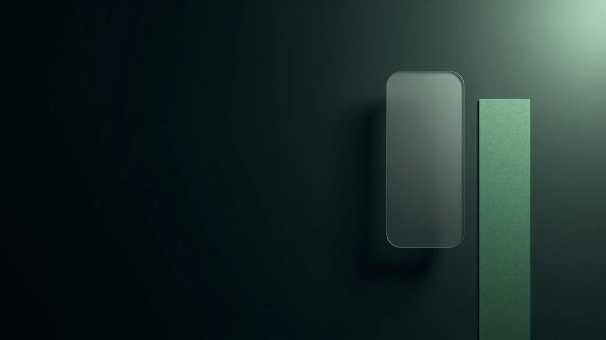

<div align="center">



# chat-servant · YanShi

**A desktop WeChat single-chat assistant — captures the chat window via WGC, runs local offline OCR, evaluates conversational intent, drafts candidate replies, and fills or dispatches them according to your selected tier.**

**Frames stay in memory and never touch disk · API keys live only in the OS credential store · Fill-only (`Manual`) by default**

[](https://seasontemple.github.io/chat-servant/)
[](LICENSE)
[](https://www.rust-lang.org/)
[](https://learn.microsoft.com/windows/)
[](https://github.com/SeasonTemple/chat-servant/actions/workflows/ci.yml)

[✨ Interactive Live Demo](https://seasontemple.github.io/chat-servant/) · [Chinese](README.md) · [English](README.en.md) · [Privacy](#privacy-and-security-boundaries) · [Getting started](#getting-started) · [Probes](#developer-probes) · [Gate](#quality-gate) · [Contributing](CONTRIBUTING.md)

</div>

---

## Core Design

**chat-servant (`YanShi`)** docks beside your active WeChat window as a tactile torn-paper note panel. It reads incoming messages, analyzes conversational intent, and hands you candidate reply drafts to eliminate context-switching overhead. Three architectural principles govern its behavior:

- **Non-intrusive visual capture**: No database reading, no process hooking, no memory inspection, and no storage decryption. The sole input path is window-level Windows Graphics Capture (WGC) paired with local offline OCR (PP-OCRv6).
- **Tiered dispatch held in Rust**: Sending is divided into two explicit tiers — `Manual` (fill into the input box only) and `Auto` (automatic send) — defaulting to `Manual`. Both the sending tier and the outbound image switch are owned by the Rust backend; the UI only renders state and forwards user requests.
- **Zero calls during silence**: Model inference triggers only when the perception pipeline detects a new message from the other party. Quiet periods incur zero network requests and zero token cost.

## Privacy and Security Boundaries

These constraints are enforced as product invariants backed by compile-time attributes and automated tests:

- **Visible local conversations only**: The application only observes chat windows already open and viewable by you on your own device.
- **Zero process intrusion**: No code injection, no API hooks, no database decryption, and no access to target process memory.
- **Frames never touch disk**: Captured window frames reside strictly in memory — never written to disk, logged, or uploaded. The sole exception is the explicit developer command `cargo xtask probe frame`, which writes a single frame to `target/probe/` (gitignored) and prints a notice to the terminal.
- **No financial actions**: UI interactions and the drafting system prompt strictly block **transfer, red-packet, collection, and payment** topics, refusing to draft money-related replies (guarded by the unit test `the_draft_prompt_still_forbids_money_topics`).
- **Credential isolation and redaction**: API keys are read exclusively from Windows Credential Manager or environment variables — never stored in config files, command-line arguments, logs, or frontend bundles. All outbound logs and error strings are redacted.
- **Isolated real-chat golden fixtures**: Pixel-level golden test fixtures derived from real conversations are excluded via `.gitignore`. Tests requiring them are marked `#[ignore]` (local-only): a standard `cargo test --workspace` reports them as `N ignored` in the summary so skipped verification remains machine-readable. Run them locally with `cargo test --workspace -- --include-ignored`.

## Safety Controls

All outbound and session-binding switches default to their most conservative state:

| Control | Default | Behavior |
| --- | --- | --- |
| Sending tier | **Fill only (`Manual`)** | Places the selected draft into the chat input box at the cursor. Sending requires explicitly raising the tier to `Auto`, which resets to `Manual` when the session ends. |
| Images outbound | **Off** | Controls whether incoming image regions are cropped, encoded, and sent to a multimodal model. |
| Session identity gate | **Locked on first frame** | Identifies the target conversation via a header pixel fingerprint (`HeaderPrint`) and maintains up to 16 isolated session buckets. Re-lock from the **system tray menu**, or switch between `Lock Current` and `Auto Follow` in Settings. |

Both the sending tier (`TierCell`) and the outbound image switch (`ImagesOut`) are held in Rust as the single source of truth; the frontend never maintains an independent copy.

## Getting Started

**System requirements**: Windows 10 version 1803 or later (for Windows Graphics Capture). Windows 11 is recommended.

```powershell
# 1. Install frontend dependencies (tauri CLI is included as a devDependency)
cd ui; pnpm install; cd ..

# 2. Start development mode (with HMR)
cd ui; pnpm tauri dev

# 3. Build installers (msi + nsis)
cd ui; pnpm tauri build
```

Once launched, the resident background thread (`cs-watch`) monitors the target WeChat window and perceives new messages via local offline OCR with line-level caching.

### Running Without an API Key

Window capture, local OCR, bubble anchoring, and candidate paper strips work out of the box without an API key. Candidate replies are served by a built-in preset transport and explicitly labeled as preset drafts so you can verify the local pipeline before connecting a model provider.

### Configuring Providers and API Keys

API keys are read from two locations only:

1. **Windows Credential Manager**, under target `chat-servant/<provider>`;
2. **Environment variables**, named `<PROVIDER>_API_KEY`.

Keys entered in the Settings screen are stored directly in Windows Credential Manager. Clicking "Test connection" queries the read-only `/v1/models` endpoint at **zero token cost**.

Supported providers fall into two categories:

- **Built-in presets**: Includes `openai`, `anthropic`, `minimax`, `deepseek`, and dedicated Jev decision endpoints (see `Provider::PRESETS` in `crates/reason/src/transport.rs` for the authoritative list);
- **Custom endpoint (`custom`)**: Connects to any OpenAI-compatible or Anthropic-compatible service URL.

## Developer Probes

Use the built-in `xtask` diagnostic probes to inspect capture, OCR, and perception stages without guessing. All probes are read-only in memory except `probe frame`:

```powershell
cargo xtask caps                    # Check whether this machine supports Windows Graphics Capture (WGC)
cargo xtask occluded                # Check whether the target window is covered, minimized, or invisible
cargo xtask probe frame             # Capture a single frame into target/probe/ for visual inspection
cargo xtask read                    # Capture a frame and run local OCR immediately
cargo xtask perceive --file <png>   # Run perception: per-line speaker classification and message merge
cargo xtask measure                 # Calibrate bubble fill, ink color, and contrast ratios
cargo xtask media <png>             # Detect image regions and verify the crop/encode path
cargo xtask e2e                     # Run end-to-end pipeline (dry-run by default; --inject fills the input box)
cargo xtask secret-scan             # Scan the repository for accidentally committed secrets
```

Run `cargo xtask caps` and `cargo xtask occluded` first if the panel appears idle — capture errors report the exact cause (occluded, minimized, or not visible).

## Quality Gate

Run the full quality gate before committing to ensure every check passes:

```powershell
pwsh -NoProfile -File scripts/gate.ps1
```

The gate executes encoding and control-character scans, `cargo fmt`, `cargo clippy -D warnings`, `cargo test`, `secret-scan`, `cargo deny check`, `svelte-check`, frontend linting + `svelte-autofixer`, and `vite build`. `.github/workflows/ci.yml` mirrors `gate.ps1` step for step, enforced by `scripts/check-gate-parity.ps1`.

> Verify the final `GATE: ALL GREEN` / `GATE: FAILED` banner printed by the script rather than relying on the process exit code alone.

## Architecture

| Module / Directory | Responsibility |
| --- | --- |
| `crates/core` | Domain types, pure logic, and state machines (`#![forbid(unsafe_code)]`) |
| `crates/capture` | Window discovery, Windows Graphics Capture, and local offline OCR |
| `crates/perceive` | Speaker attribution, noise filtering, and session identity gate (`#![forbid(unsafe_code)]`) |
| `crates/reason` | Intent evaluation and candidate drafting — **the only stage allowed to access the network** (`#![forbid(unsafe_code)]`) |
| `xtask` | Developer diagnostic probes and automation utilities |
| `ui/` · `ui/src-tauri/` | SvelteKit 5 torn-paper frontend and Tauri 2 desktop shell (IPC commands, system tray, watch loop) |

Rust is the single source of truth: all session state, sending tiers, and outbound switches live in the Rust core, while the frontend renders state and forwards user actions.

## Documentation

- [`CONTEXT.md`](CONTEXT.md) — Domain glossary and system boundaries (**read before modifying code**)
- [`docs/adr/`](docs/adr/) — Architecture Decision Records, including rejected alternatives
- [`docs/release-notes/`](docs/release-notes/) — Bilingual release notes
- [`CONTRIBUTING.md`](CONTRIBUTING.md) — Contribution workflow and maintenance pitfalls
- [`AGENTS.md`](AGENTS.md) — Working agreements and engineering discipline for agents

## License

Licensed under the [Business Source License 1.1 (BSL-1.1)](LICENSE) © SeasonTemple:

- **Source visibility and baseline rights**: Free to copy, modify, and redistribute, and **free for non-production use**;
- **Additional Use Grant**: Evaluation, personal use, internal use within an organization, and modification are **always permitted**. Production use is restricted only when offering the work to third parties on a hosted or embedded basis as a product or service whose primary function is the same as, or substantially overlaps with, this project (refer to the exact wording in [`LICENSE`](LICENSE));
- **Change Date**: On **2029-10-12**, the license automatically converts to **Apache-2.0**.

> **Commercial licensing**: No commercial purchase channel is currently open, and nothing in this repository grants production rights for restricted hosted/embedded offerings. Contact the licensor beforehand if your use case requires a commercial license.
